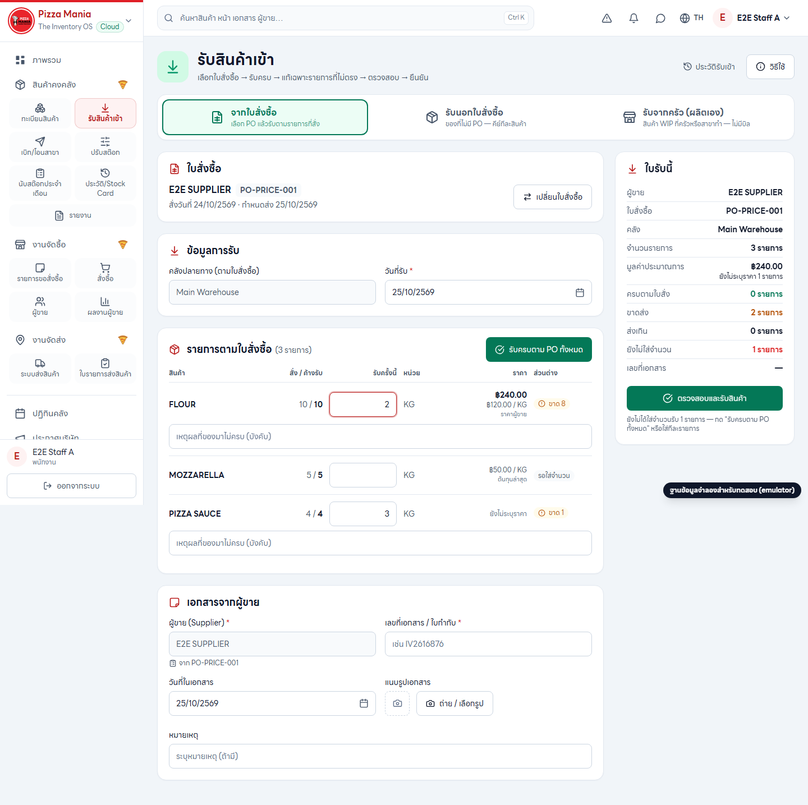
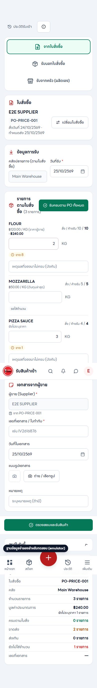

# R69 AGENT02: Receive Prices UI & E2E Verification

**Status: REVIEW_PENDING**

Finish line prices and receipt total estimates on PO goods receiving screen (`/receive`).

---

## 1. Verified Behaviours (Code Audit)

Diff inspection against base `934cbfa`:

| Behaviour | File : Line | Verification Details |
|---|---|---|
| **Missing price shows "ยังไม่ระบุราคา" (never 0)** | `src/pages/receive/receipt.ts:291-292` `src/pages/receive/PoLines.tsx:126, 163` `src/lib/receiptPrice.ts:16-17, 72-74` | When no price is resolvable (`source === 'missing'`), `unitPrice: null`. `priceSourceLabel()` returns `t('ยังไม่ระบุราคา')`. Desktop and mobile render `{sourceLabel}` in faint ink without currency prefix or 0 value. |
| **Unentered quantity shows no amount and is not counted** | `src/pages/receive/receipt.ts:311, 339` `src/pages/receive/PoLines.tsx:121-123, 150-154` `src/lib/receiptPrice.ts:89-91, 102-113` | When quantity input is empty (`qty === null`), `lineAmount` evaluates to `null`. UI conditionally gates amount rendering on `{amount !== null && ...}`. In `receiptTotal()`, unentered lines increment `unenteredLines` and are excluded from `estimatedTotal` and `missingLines`. |
| **Supplier items loaded once per order; stale brand result ignored** | `src/pages/Receive.tsx:162-182` | `useEffect` triggered on `[order]`. Captures `brandEpoch()`. If brand changes while `listSupplierItems()` is in flight or component unmounts (`alive = false`), result is discarded. `onBrandChange` immediately clears state. |
| **Qty / variance / reason validation unchanged** | `src/pages/receive/PoLines.tsx:96-98` `src/pages/Receive.tsx:265-276` `src/pages/receive/receipt.ts:95-98` | Variance computation (`variance(due, qty)`), mandatory short/over reason check (`needsReason(due, e)`), and refusal/exception list creation are completely unchanged. |

---

## 2. Before & After

- **Before:** Receive PO lines showed only ordered vs owed quantities, unit, and variance chip. Staff had no visibility into unit cost or supplier buying prices at time of receipt, and no estimated total receipt valuation was displayed in the summary card.
- **After:**
  - Each line displays resolved unit price (`฿X.XX / unit`) and source badge (`ราคาผู้ขาย`, `ต้นทุนล่าสุด`, or `ต้นทุน ณ {date}`).
  - Entered quantities show calculated satang line totals (`฿X.XX`).
  - Unpriced lines display `ยังไม่ระบุราคา` (never ฿0.00).
  - Unentered lines display unit price only with no line amount.
  - "ใบรับนี้" summary panel includes estimated receipt total (`มูลค่าประมาณการ ฿X.XX`) and amber alert if any entered lines are unpriced (`ยังไม่ระบุราคา N รายการ`).

### Evidence Screenshots

- **Desktop (1440px):**
  `docs/evidence/receive-price/receive-price-1440.png`
  

- **Mobile (390px):**
  `docs/evidence/receive-price/receive-price-390.png`
  

---

## 3. Test & Build Counts

| Verification Check | Exact Result | Status |
|---|---|---|
| Focused Unit Tests | `tests/receive-prices.test.ts` (6 tests) `tests/receipt-price.test.ts` (28 tests) **Total: 34 passed (2 test files)** | PASS |
| TypeScript Compiler | `npx tsc -b` | PASS (0 errors) |
| Linter | `npx oxlint` | PASS (0 errors) |
| Translations | `npm run -s i18n:check` | PASS (0 missing) |
| E2E Spec | `e2e/receive-prices.spec.ts` (Playwright + Firebase Emulators) | PASS (1 passed, 10.7s) |
| Full Test Suite | `npx vitest run` | PASS (143 test files passed, 1748 tests passed) |
| Production Build | `npm run -s build` (Vite + 4 TS configs + SW) | PASS (1447 modules transformed, dist/sw.js generated) |

---

## 4. Environment & Delivery Details

- **Provider / Model:** `antigravity` / `9router/gemini-3.8-flash-high`
- **Worktree:** `C:\Users\Yutthachai\.t3\worktrees\PZM-LLP-Stock-2026\t3-906a8bea`
- **Branch:** `feat/20261024-receive-prices-r2`
- **Base Commit:** `8e9108ebd9e9cd088f300643c6f6e0f218ca7e38`
- **Commits:**
  - `aac5879`: `test(receive): add e2e spec for receive prices and capture evidence`
  - (pending commit): `docs(mission): deliver r69 agent02 receive-prices report`
